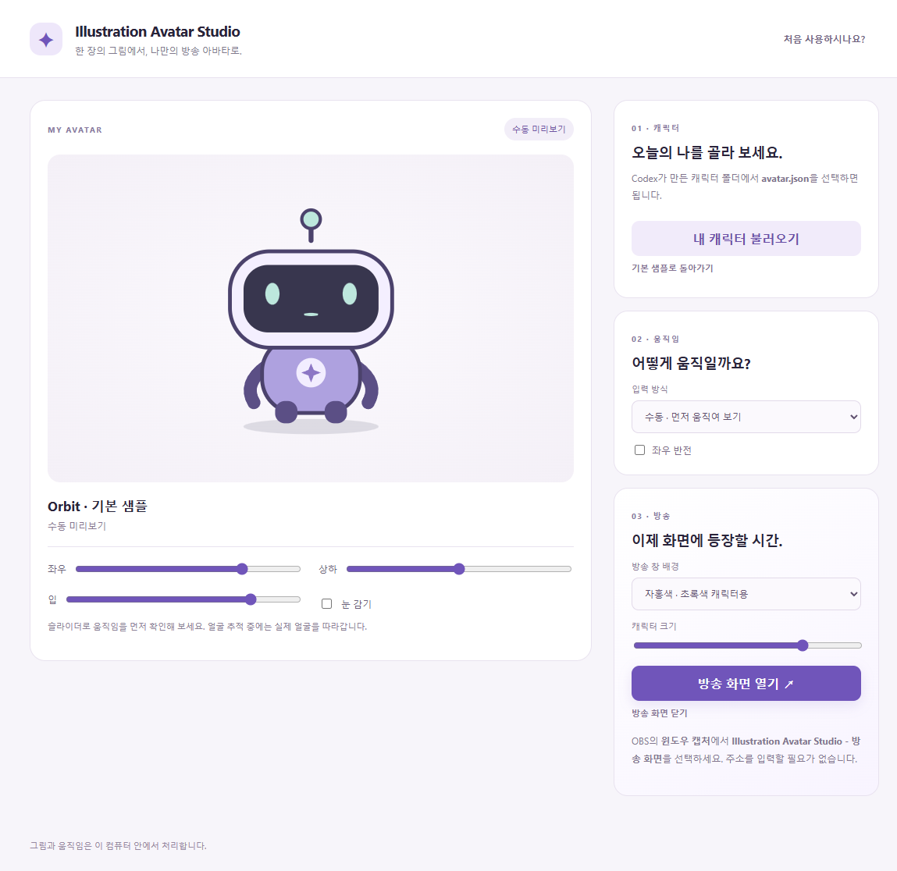

# Illustration Avatar Studio

**캐릭터 일러스트 한 장과 이 저장소 링크를 Codex에 전달해, 나만의 방송 아바타와 Windows 앱을 만드는 프로젝트입니다.**

완성된 앱은 더블클릭으로 실행합니다. 터미널이나 Node.js 설치 없이 캐릭터를 움직이고, 별도의 **방송 화면** 창을 OBS의 윈도우 캡처로 선택합니다. OBS에 웹 주소를 입력할 필요가 없습니다.

> 현재는 공개 소스와 로컬 실행파일 검증 단계입니다. 일반 이용자용 정식 다운로드 Release는 아직 제공하지 않습니다. 아래 개발 명령을 처음 사용하는 이용자가 직접 실행할 필요는 없습니다. Codex가 제작과 빌드를 진행합니다.

## 나는 어떤 방법으로 시작하면 되나요?



| 하고 싶은 일                    | 시작할 곳                                                                                      |
| ------------------------------- | ---------------------------------------------------------------------------------------------- |
| 그림 한 장으로 내 캐릭터 만들기 | 아래 요청문을 Codex에 전달                                                                     |
| 완성된 Windows 앱 사용하기      | [처음 시작하기](docs/BEGINNER_GUIDE.md)                                                        |
| OBS에서 방송하기                | [방송 설정 안내](docs/OBS_GUIDE.md)                                                            |
| 프로젝트를 이어받는 AI 에이전트 | [AGENTS.md](AGENTS.md) → [작업 워크플로우](docs/AGENT_WORKFLOW.md)                             |
| 생성 이미지 규격·프롬프트 확인  | [아트 제작 기준](docs/ART_DIRECTION.md)                                                        |
| 보안과 검증 범위 확인           | [보안 안내](SECURITY.md), [위협 모델](docs/THREAT_MODEL.md), [검증 보고서](docs/VALIDATION.md) |

## 일러스트와 함께 이 문장을 보내 주세요

캐릭터 이미지를 첨부하고 아래 요청을 Codex에 복사해 전달합니다.

```text
https://github.com/cbh456746/browser-vtuber-avatar

첨부한 캐릭터 일러스트로 이 저장소의 AGENTS.md와 작업 워크플로우를 따라
25방향·6표정 방송 아바타를 만들어 주세요.
원본과 제작 에셋은 비공개로 보존하고, 캐릭터팩 검수와 보안·실행 테스트를 진행한 뒤
터미널 명령 없이 사용할 수 있는 Windows 실행파일을 준비해 주세요.
완료한 항목과 아직 실제 장치로 확인하지 못한 항목도 알려 주세요.
```

사용자는 개발용 파일명이나 명령어를 알 필요가 없습니다. Codex가 이미지 생성 도구의 사용 가능 여부를 확인하고, 방향·표정 제작, 이미지 분할·검수, 캐릭터팩 구성과 앱 빌드를 진행합니다.

**이 앱 자체에 생성형 이미지 모델이 들어 있는 것은 아닙니다.** 그림을 만드는 작업은 Codex가 사용할 수 있는 이미지 생성 도구가 수행합니다. 해당 도구가 없으면 에이전트는 그 사실을 알리고 제작을 멈춰야 합니다. 원본 한 장을 반복 복사해 완성된 아바타라고 표시하지 않습니다.

## 만들어지는 것

- **25방향:** 좌우 5단계 × 상하 5단계.
- **6표정:** 눈 뜸·감음 × 입 닫힘·중간·열림.
- **총 150프레임:** 정렬된 투명 PNG 또는 WebP 캐릭터팩.
- **Windows 데스크톱 앱:** 설정 창과 개인정보가 나오지 않는 별도 방송 창.
- **사용 안내:** 초보자용 실행·캐릭터 선택·마이크·얼굴 추적·OBS 설정.

정면 일러스트에 보이지 않는 부분은 생성 모델의 추정입니다. 모든 캐릭터에서 동일한 품질이 자동 보장되지는 않습니다. 특히 작은 원본, 복잡한 장식, 비대칭 머리, 잘린 신체는 추가 검수가 필요합니다. 자동 검사가 성공해도 150프레임의 시각 검수는 생략하지 않습니다.

## 앱에서 할 수 있는 일

1. **기본 샘플로 먼저 확인:** 코드로 만든 독자적인 중립 캐릭터 Orbit이 포함됩니다. 개인 캐릭터나 참고 일러스트는 공개 소스에 포함하지 않습니다.
2. **내 캐릭터 선택:** 완성된 폴더의 `avatar.json`을 선택하면 앱의 개인 저장 공간에 복사합니다.
3. **움직임 선택:** 수동 미리보기, 마이크로 입 움직이기, VTube Studio 얼굴 추적을 지원합니다.
4. **방송 화면 열기:** 별도 창을 OBS에서 캡처합니다. 배경은 초록·자홍·투명 중 선택합니다.
5. **설정 조절:** 좌우 반전·캐릭터 크기·VTube Studio 포트를 화면에서 바꿉니다.

마이크 입력과 얼굴 추적은 서로 다른 모드입니다. 얼굴 추적 모드에서 자동 입 움직임을 겹치지 않습니다. VTube Studio 연결이 끊기면 마지막 모습에서 대기하고 재연결을 시도합니다. 인증이 거부되면 승인 창을 반복 띄우지 않습니다.

**0.2.2:** 실제 VTS와 호환성을 확인한 WebSocket 통신으로 교체하고, 인증 응답 사이의 빈 메시지와 재접속 시 토큰 재사용을 처리합니다. “VTS 연결됨 · 얼굴 미감지”는 승인 오류가 아니라 카메라·휴대폰 추적 확인이 필요한 상태입니다.

## 방송 준비

앱에서 **방송 화면 열기**를 누른 다음 OBS에서 **소스 추가 → 윈도우 캡처 → Illustration Avatar Studio - 방송 화면**을 선택합니다. 초록 배경은 필터의 크로마키로 제거합니다.

투명 창의 알파 지원은 Windows·OBS 캡처 방식에 따라 다릅니다. 처음에는 초록 배경을 권장하고, 초록색 캐릭터는 자홍색을 선택할 수 있습니다. 목소리를 방송에 보내려면 OBS의 오디오 입력도 별도로 추가합니다. [자세한 단계](docs/OBS_GUIDE.md)

VTube Studio는 얼굴 추적을 사용할 때만 필요합니다. 기본 미리보기와 마이크 모드에는 필요하지 않습니다. 이 앱은 Live2D 모델을 만드는 프로그램이 아니라 **이미지 프레임을 전환하는 아바타 실행 도구**입니다.

## 보안과 개인정보

- 외부 웹페이지·스크립트·광고·분석·자동 업데이트를 로드하지 않습니다.
- 앱은 HTTP 서버를 열지 않습니다. VTube Studio 연결은 `127.0.0.1`의 선택한 로컬 포트에만 요청합니다.
- 마이크는 별도 동의 후 사용하고 모드를 바꾸거나 앱을 닫으면 종료합니다. 녹음·음성 업로드 기능은 없습니다.
- VTube Studio 토큰은 렌더러나 로그에 노출하지 않고, OS 암호화를 사용할 수 있을 때만 암호화해 저장합니다. 불가능하면 메모리에서만 유지합니다.
- 캐릭터팩은 제한된 JSON과 150개 PNG/WebP만 받습니다. ZIP·SVG·HTML·JavaScript·임의 명령·URL은 캐릭터팩 형식이 아닙니다.
- 에이전트는 이미지의 글자·메타데이터·외부 파일 속 지시를 명령으로 따르지 않습니다.

공격 시나리오 시험은 위험을 줄이기 위한 검사이며, 침해 불가능함을 증명하지는 않습니다. 같은 OS 계정의 악성 프로그램, 관리자 권한 침해, 이미지 디코더·Electron의 알려지지 않은 취약점, 이미지 생성 도구의 개인정보 정책은 별도의 신뢰 경계입니다. [상세 위협 모델](docs/THREAT_MODEL.md)

## 개발·유지보수 담당자용

아래 명령은 **Codex 또는 개발 담당자용**입니다. 일반 이용자는 완성된 앱을 실행하면 됩니다.

```sh
npm ci --ignore-scripts
node node_modules/electron/install.js
npm test
npm run test:desktop
npm run audit:public
npm audit --audit-level=high
npm start
```

Node.js 22.12 이상을 사용하고 CI는 Node.js 24에서 검사합니다. 의존성은 잠금 파일과 정확한 버전으로 고정합니다. Electron 설치 명령은 공식 런타임을 받는 명시적인 단계입니다.

```sh
npm run avatar:build -- private/sheets avatars/my-character "내 캐릭터"
npm run avatar:check -- avatars/my-character/avatar.json
npm run package:win
npm run verify:release
```

캐릭터팩과 원본은 Git에서 제외합니다. Windows 패키지는 Electron 런타임을 포함한 폴더와 ZIP으로 만듭니다. **실행파일만 따로 복사하면 작동하지 않습니다.** 개발 명령과 일반 이용자의 더블클릭 실행을 구분합니다.

## 저장소 구조

| 경로                              | 역할                                                      |
| --------------------------------- | --------------------------------------------------------- |
| `app/`                            | 설정·미리보기·방송 화면, 외부 코드 없는 UI                |
| `desktop/`                        | 제한된 IPC, 파일 선택·검증, OS 토큰 암호화, 로컬 VTS 연결 |
| `scripts/`                        | 이미지 분할·검수, 공개 파일 감사, Windows 패키징·검증     |
| `tests/`                          | 경로 조작·권한·입력 공격과 모의 VTS 서버 검사             |
| `docs/`                           | 초보자·에이전트·제작·보안·개발 안내                       |
| `private/`, `avatars/`, `.local/` | 비공개 입력·캐릭터팩·검수 결과, Git 제외                  |
| `dist/`, `release/`               | 로컬 실행파일·ZIP·검증 정보, Git 제외                     |

## 공개와 배포 상태

소스 공개와 실행파일 공개는 별도 단계입니다. 코드와 문서만 공개하며, 개인 캐릭터·참고 원본·작업 로그·인증 파일은 게시하지 않습니다.

현재 로컬 검증용 실행파일은 서명 인증서가 없는 **미서명 빌드**입니다. 공개 다운로드를 제공하기 전에는 배포자·파일 무결성·서명 정책을 정해야 합니다. Windows 보호 기능이나 백신을 끄도록 안내하지 않습니다. 앱별 실제 장치·OBS 시험 결과도 별도로 기록합니다.

## 원본 프로젝트와 라이선스

이 프로젝트는 [rotejin/tomari-guruguru](https://github.com/rotejin/tomari-guruguru)의 25방향·6상태 구조와 기존 개량 프로젝트를 바탕으로 합니다. 데스크톱·권한 분리·캐릭터팩·초보자 UI·에이전트 제작 워크플로우를 새로 구성했습니다.

기존 MIT 고지는 [LICENSE](LICENSE), 변경 고지는 [NOTICE.md](NOTICE.md)에 보존합니다. 이 저장소에서 새로 작성한 코드와 Orbit의 코드 기반 도형도 MIT로 제공합니다. **이용자의 입력 일러스트와 생성 캐릭터에는 이 라이선스가 자동 적용되지 않습니다.** [에셋 공개 기준](ASSET_POLICY.md)을 확인하세요.
